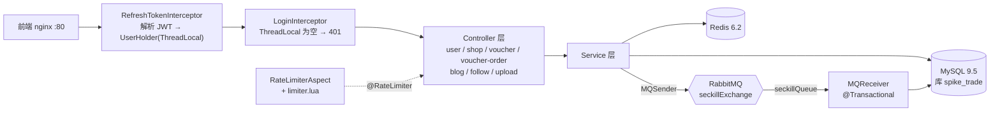
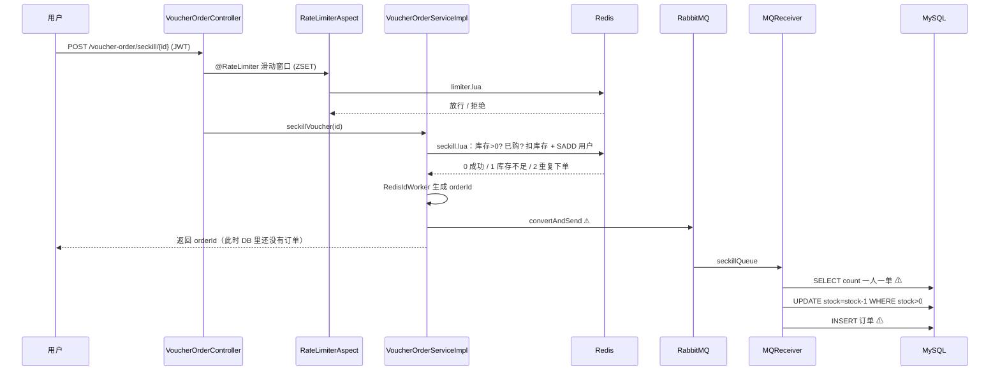

# 基线架构全景（改造前）

> 2026-10-21 读代码整理，范围：`F:\study\spike-base` @ `5be0b4c`。标「待验证」的是读代码推断，尚无运行证据。

## 1. 一句话

单体 Spring Boot（约 4200 行，端口 8081），前面是 nginx 静态前端；数据在 MySQL，热数据与秒杀资格判断在 Redis，秒杀落库靠 RabbitMQ 异步。

## 2. 组件与请求入口

## 3. 秒杀时序（⚠ 为已知缺陷位置）

要点：用户拿到 orderId 时订单还没落库，这是**异步下单**的代价，也是后续需要「最终一致 + 对账」的原因。

## 4. Redis 用了什么

| Key（前缀） | 结构 | 用途 | 来源 |
| --- | --- | --- | --- |
| `login:code:` | String，TTL 2 分钟 | 短信验证码 | RedisConstants |
| `seckill:stock:{voucherId}` | String | 秒杀库存 | RedisConstants；`addSeckillVoucher` 写入 |
| `seckill:order:{voucherId}` | Set | 已购用户 | `seckill.lua` 里直接写字面量 |
| `cache:shop:{id}` | String（JSON + 逻辑过期） | 商户缓存 | RedisConstants / CacheClient |
| `cache:voucher:detail:{id}` | String，TTL 120s | 优惠券详情（外加 Caffeine 本地缓存） | VoucherServiceImpl |
| `lock:shop:{id}` | String | 重建缓存的互斥锁 | RedisConstants |
| `blog:liked:` / `feed:` | ZSet | 点赞排行 / 关注推送收件箱 | RedisConstants |
| `shop:geo:` | GEO | 附近商户 | RedisConstants |
| `sign:` | Bitmap | 签到 | RedisConstants |
| `limit/seckill` + 类名 + 方法名 | ZSet | 滑动窗口限流 | RateLimiterAspect |
| 关注关系 | Set | 共同关注 | FollowServiceImpl |

## 5. 已知缺陷在图上的位置

| # | 缺陷 | 位置 |
| --- | --- | --- |
| 1 | Lua 扣库存后 MQ 发送失败，券永久损失 | 时序图 S→Q |
| 2 | 无 `(user_id, voucher_id)` 唯一索引 | 时序图 W→D |
| 3 | 失败消息被丢弃或无限重投 | 时序图 W→D（INSERT） |
| 4 | 判空顺序错（先取 id 再判 null） | `seckillVoucher()` 开头 |
| 9/10 | JWT 密钥耦合 / 登录态脱离 Redis | RefreshTokenInterceptor |
| 11/12 | 商户缓存未命中不查库 / 二级缓存名不副实 | CacheClient / CaffeineConfig |

## 6. 本轮读代码的新发现（待验证）

- **A. 限流参数会卡死压测**：秒杀接口注解为 `window=100, limit=5, type=METHOD`。`limiter.lua` 把 window 当秒用，METHOD 维度不区分用户，等于**全体用户 100 秒内总共只放行 5 次**。压测前必须调大或临时关闭。
- **B. 限流提示丢失**：`RateLimitException` 继承 `RuntimeException`，没有专门处理器，会被 `WebExceptionAdvice` 统一转成「服务器异常」，「秒杀活动太火爆」到不了前端。
- **C. README「Redis 无自动预热」需要修正**：`POST /voucher/seckill` 创建秒杀券时会写 `seckill:stock:{id}`；只有手工 SQL 造券才需要手工预热。另外这次 Redis 写入发生在 `@Transactional` 方法内，事务回滚时 Redis 里会留下脏库存。
- **D. Redisson 未真正使用**：`VoucherOrderServiceImpl` 引入了 `RedissonClient` 但没用到，仅 `RedissonTest` 使用，与「Redisson 未接入」一致。
- **E. MQ 没有可靠性配置**：已读到的 `rabbitmq` 配置段里没有 publisher confirm / return，也没有死信交换机。
