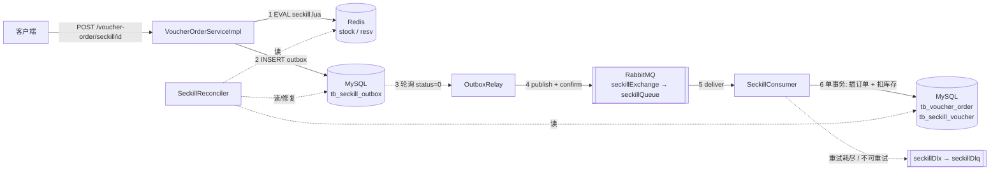

# J1 秒杀可靠性主链 · plan

> 回答「应该怎么实现」。需求见 `spec.md`，取舍见 `adr-001-reliable-publish.md`。

## 1. 架构概览

一个订单号（= 消息 ID）贯穿：接口返回值 → `tb_seckill_outbox.id` → 消息头 `message_id` → 订单主键 `tb_voucher_order.id`。

## 2. 核心数据结构

### 2.1 Redis

| key | 类型 | 含义 |
| --- | --- | --- |
| `seckill:stock:{voucherId}` | string（已有） | Redis 侧库存，需预热 |
| `seckill:resv:{voucherId}` | **zset（新）** | 已预约用户：member = userId，score = 预约时刻（Unix 秒）。取代旧的 `seckill:order:{id}` set，因为需要时间来区分「在途」与「孤儿」 |

### 2.2 MySQL（迁移脚本 `src/main/resources/db/migration/J1-001-reliability.sql`，同步写入 `src/main/resources/db/schema.sql`）

`tb_voucher_order` 新增 `UNIQUE KEY uk_user_voucher (user_id, voucher_id)`。

`tb_seckill_outbox`：

| 列 | 类型 | 说明 |
| --- | --- | --- |
| `id` | bigint PK | = 订单号 = 消息 ID |
| `user_id` / `voucher_id` | bigint unsigned | 业务键；`UNIQUE KEY uk_outbox_user_voucher (user_id, voucher_id)` |
| `payload` | varchar(512) | 消息体 JSON：`{"id":..,"userId":..,"voucherId":..}` |
| `status` | tinyint | 0 NEW 待发/待确认；1 SENT 已被 broker 确认；2 DEAD 对账判定终止 |
| `attempts` | int | 已领取发送的次数（退避依据） |
| `resend_count` | int | 被对账重发的次数（上限 3，防止确定性失败无限循环） |
| `next_retry_at` | timestamp(3) | 下次可被领取时间；领取时推后一个 lease |
| `last_error` | varchar(255) | 最近一次失败原因 |
| `create_time` / `update_time` | timestamp | 对账用「停留时长」判断 |

索引：`KEY idx_outbox_status_retry (status, next_retry_at)`、`KEY idx_outbox_voucher (voucher_id)`。

### 2.3 RabbitMQ

| 名称 | 类型/用途 |
| --- | --- |
| `seckillExchange`（topic，已有）→ `seckillQueue`（已有），绑定键 `seckill.#`，发送路由键 `seckill.message` | 主链 |
| `seckillDlx`（direct，新）→ `seckillDlq`（新），路由键 `seckill.dead` | 死信，消息头携带 `x-exception-message` / `x-exception-stacktrace` / `x-original-*` |

### 2.4 配置项（`application.yaml`，均有默认值）

`spring.task.scheduling.pool.size=2`（避免 relay 阻塞对账）、`trade.seckill.relay.{enabled=true, interval-ms=200, batch-size=50, lease-ms=5000}`、`trade.seckill.consumer.{max-attempts=3, initial-interval-ms=500, max-interval-ms=5000}`、`trade.seckill.reconcile.{enabled=true, interval-ms=60000, grace-seconds=30, http-enabled=false}`；RabbitMQ 侧开启 `publisher-confirm-type: correlated`、`publisher-returns: true`、`template.mandatory: true`、`connection-timeout: 3000ms`，`listener.simple.default-requeue-rejected: false`（死信发布也失败时消息被丢弃，由对账 C 类补发），并**移除**会阻塞调用线程的 `template.retry`。

## 3. 核心接口

| 位置 | 签名 | 说明 |
| --- | --- | --- |
| HTTP（不变） | `POST /voucher-order/seckill/{id}` → `Result{data=orderId}` | 返回时订单未必已落库 |
| HTTP（新，默认关） | `GET /voucher-order/reconcile/{voucherId}` → `ReconcileReport` | 需登录；`trade.seckill.reconcile.http-enabled=true` 才注册 |
| `seckill.lua` | `KEYS[1]=stock, KEYS[2]=resv; ARGV[1]=userId, ARGV[2]=nowSec` → `0/1/2/3` | 见 spec FR1 |
| `seckill_unreserve.lua` | `KEYS[1]=stock, KEYS[2]=resv; ARGV[1]=userId` → `1` 已回滚 / `0` 本就不存在 | `ZREM` 成功才 `INCR`，幂等 |
| `seckill_snapshot.lua` | `KEYS[1]=stock, KEYS[2]=resv` → 字符串 `"<stock\|nil>:<zcard>"` | 原子读取一对值，对账用 |
| `OutboxService.insertNew(id, userId, voucherId)` | 写 outbox，唯一键冲突抛异常 | 请求线程调用 |
| `OutboxRelay.poll()` | `@Scheduled` | 领取 → 发送 → 同步等待 confirm（最长 `lease-ms`）→ 标记 |
| `SeckillOrderHandler.createOrder(msg)` | `@Transactional` → `CREATED / DUPLICATE_DELIVERY` | 不可恢复情况抛 `NonRetryableSeckillException` |
| `SeckillReconciler.reconcile(voucherId)` | → `ReconcileReport` | 见 §5.4 |

## 4. 包与类

新增包 `com.spiketrade.seckill`：`SeckillMessage`、`OutboxService`、`OutboxRelay`、`SeckillOrderHandler`、`SeckillConsumer`、`NonRetryableSeckillException`、`SeckillRetryPolicies`、`SeckillScripts`、`SeckillReconciler`、`ReconcileReport`、`ReconcileController`；`config/SeckillMqConfig`（模板回调、监听容器工厂、重试拦截器）；`entity/SeckillOutbox`；`mapper/SeckillOutboxMapper`、`mapper/SeckillReconcileMapper`。删除 `rebbitmq` 包（`MQSender` / `MQReceiver` 被取代）。

## 5. 关键流程

### 5.1 下单（正常）

1. 判空：`UserHolder.getUser()` 为空 → 返回「需要登录」（#4）。
2. 执行 `seckill.lua`；`1/2/3` 直接返回对应提示。
3. 生成订单号；`OutboxService.insertNew`。outbox 写入使用 5 秒事务超时（明显小于默认 30 秒宽限期）；**任何异常** → 执行 `seckill_unreserve.lua` 回滚预约 → 返回「系统繁忙」。
4. 返回订单号。

### 5.2 投递与消费

- relay 每 200 ms 取 `status=0 AND next_retry_at<=NOW(3)` 的行（≤50），逐行 `claim`（条件更新：`attempts+1`、`next_retry_at=NOW+lease`，影响行数为 1 才算领到），然后带 `CorrelationData(id)` 和 `message_id` 发布。
- 收到 ack 且无 return → `status=1`；nack、return、发送异常 → 按 `LEAST(POW(2, attempts-1), 60)` 秒退避；确认迟迟不来 → lease 到期后被再次领取（可能重复发，由消费端幂等吸收）。
- 发送遇连接类异常时结束当前批次，下一轮再按退避领取，不在同一批次逐行等待连接超时。
- 消费者在一个事务里：**先插订单**（主键冲突且该 id 已存在 → `DUPLICATE_DELIVERY`，正常确认；冲突但 id 不存在 → 同用户另一订单 → 不可重试），**再** `UPDATE ... SET stock = stock - 1 WHERE voucher_id = ? AND stock > 0`，影响行数不为 1 → 不可重试并回滚订单。
- 监听容器重试：可重试错误最多 3 次（0.5 s 起，×2）；耗尽或不可重试错误由 `RepublishMessageRecoverer` 发布到 `seckillDlx`，然后确认原消息。

### 5.3 故障窗口与对策

| 窗口 | 现象 | 对策 | 由谁闭合 |
| --- | --- | --- | --- |
| W1 Lua 成功 → outbox 写入前进程崩溃 | 孤儿预约（Redis 有预约，库无任何记录） | 对账 A 类回滚 | 对账 |
| W1' Lua 成功 → outbox 写入失败（进程活着） | 同上 | 请求内立即 unreserve | 请求线程 |
| W2 broker 宕机 / nack / 不可路由 | outbox 行停在 NEW | relay 退避重试，恢复后补发 | relay |
| W3 同一消息投递多次 | 潜在重复订单 | 订单主键 + 唯一索引 | 消费者 |
| W4 消息已确认但从未落库（消费失败进死信等） | outbox=SENT 且无订单 | 对账 C 类重发（≤3 次）或终止 | 对账 |
| W5 数据库库存不足而 Redis 放行 | 两侧库存漂移 | 不可重试 → 死信；对账 E 类报告 | 人工 |

### 5.4 对账（单券）

输入：Redis 一对值 `(R, Z)`（`seckill_snapshot.lua` 原子读取 `stock` 与 `zcard`）、预约成员及时间、outbox 全部行、订单 `(id, user_id)`、数据库 `(D, O)`（一条 SQL 同时读 `stock` 与订单数）。

| 类 | 判定 | 动作 |
| --- | --- | --- |
| A 孤儿预约 | 用户在预约集合中，预约时间早于「现在 − 宽限期」，且既无订单也无 outbox 行 | **修复**：`seckill_unreserve.lua` |
| B 停滞待发 | outbox `status=0` 且创建已超过宽限期 | 报告（relay 在处理；常见于 broker 宕机） |
| C 已发无单 | outbox `status=1`、停留超过宽限期、无 `id` 相同的订单：若同用户已有别的订单 → 置 DEAD（`SUPERSEDED`）；否则 `resend_count<3` → 置回 NEW 并 `resend_count+1`；否则置 DEAD（`EXHAUSTED`） | **修复** |
| D 订单缺预约 | 有订单的用户不在预约集合中 | 报告（多为 Redis 丢数据；不自动重建） |
| E 库存漂移 | `(R + Z) ≠ (D + O)` | 报告差值 |

**E 为什么是恒等式而不是估算**：预约时 Lua 同时 `库存−1`、`Z+1`，`R+Z` 不变；回滚时同理；消费者事务同时 `D−1`、`O+1`，`D+O` 不变。初始时两侧都等于总库存，所以两侧恒等，与消息在途多少无关——前提是各自原子读取（`seckill_snapshot.lua`；`(D,O)` 用单条 SQL）。因此 E 不需要宽限期。

## 6. 技术取舍

| 选 | 不选 | 理由 |
| --- | --- | --- |
| 本地消息表 + relay | RocketMQ 事务消息 | 见 ADR-001 |
| 订单号 = 消息 ID，靠订单主键去重 | 单独建消费日志表 | 少一张表一次写入；订单创建本身就是「已消费」的事实，二者在同一事务里不会分裂 |
| 监听容器无状态重试 + `RepublishMessageRecoverer` | 队列声明 `x-dead-letter-exchange` + 拒绝不重入队 | 前者可把异常信息写进死信消息头；且**不改已有队列的声明参数**（改参数会因与已存在队列冲突而无法启动） |
| 重试错误分类（`NonRetryableSeckillException` 不重试） | 所有异常统一重试 | 库存不足、同用户重复是确定性错误，重试只会浪费并阻塞队列 |
| 预约用 zset（带时间） | 保留 set | 需要「预约时间」区分在途与孤儿 |
| 孤儿预约回滚（unreserve） | 补建 outbox 行替用户下单 | 请求已崩溃，用户没拿到订单号；回滚让用户可重新抢，语义简单 |
| 对账 A 类带宽限期 | 不带 | 避免与正在写 outbox 的请求竞争 |
| relay 无放弃上限，退避封顶 60 s | 重试 N 次后放弃 | 放弃即丢单；broker 宕机时长不可预期 |
| 对账 C 类重发有上限（3） | 无上限 | 确定性失败（如库存不足）会无限循环 |

## 7. 兼容与迁移

- 旧队列 `seckillQueue` 与消息格式不变（`{"id","userId","voucherId"}`），不改队列参数，升级时队列里的存量消息仍可被新消费者处理。
- 迁移脚本会因已有重复 `(user_id, voucher_id)` 数据而失败；脚本头部给出检查 SQL。
- J1 只支持新券，不迁移旧 `seckill:order:*`；旧 key 不再使用，升级后可手工删除，**预热库存 key 不变**。已有订单的券上，老用户可重复预约，E、D 类也会误报。

## 8. 环境注意

- 现有 `@RateLimiter(key="limit/seckill", window=100, limit=5)` 作用于秒杀方法，含义是**每 100 秒全局最多 5 次**。验证脚本在每个场景前清除 `limit/seckill*` 的 key；J4 压测前必须另行处理，不属于 J1。
- 验证脚本需要用户/WorkBuddy 在本机 Git Bash 执行（Docker、MySQL、curl）；沙箱只能验证 Lua（真实 Redis）。
